  <b>Full-Stack Developer &amp; Team Lead</b> · 6+ years · Dubai, UAE 
  Building Arabic-first government and financial platforms with Django, Laravel and Next.js

  
  
  
  

---

### About

Full-stack developer and team lead with **6+ years** delivering secure, scalable systems for **government, fintech, e-commerce, and healthcare**. I currently lead development of government digital-transformation systems at the **Crown Prince's Office in Fujairah**, specializing in Arabic-first bilingual applications with Django backends and Next.js frontends.

**Strengths:** system architecture & microservices · UAE Pass / OAuth2 SSO · AI integration (Arabic speech-to-text, summarization) · Arabic RTL interfaces · leading and mentoring backend teams

### Experience

| Period | Role | Company | Highlights |
|:--|:--|:--|:--|
| **2025 – now** | **Full-Stack Developer** | Adaa Consulting · Crown Prince's Office, Fujairah | Leading **Tarasol** government platform · UAE Pass SSO · AI Arabic transcription · microservices |
| 2025 | Backend Developer | Websters.ae | Twill CMS for a GCC platform · Lighthouse & SEO gains · ASP.NET APIs |
| 2024 – 2025 | Backend Developer | LOT.SA *(remote)* | IT ticketing system · server & Cloudflare security |
| 2023 | **Backend Team Lead** | Beseech Co. | Led **5 developers** · **+30%** transaction speed |
| 2021 – 2024 | Backend Developer | Spider Tech Co. | Fintech, e-commerce & healthcare · **−30%** query time |
| 2020 | Backend Developer | 4th Pyramids Co. · Freelance | E-commerce backends · payment gateways |

### Selected Projects

| Project | What I did |
|---|---|
| **Tarasol** · Government, UAE | Correspondence & meetings platform with Arabic RTL, UAE Pass SSO, AI transcription, and OnlyOffice collaboration |
| **Real-estate investment platform** · Saudi Arabia | Led the backend team; integrated government and banking services: Absher, Riyadh Bank B2B (MT940), Zoho Books |
| **Standing Committee on International Law** · Saudi Arabia | Official government website; led backend development |
| **Eyadda** · Healthcare | Platform connecting doctors, patients, hospitals, and labs around centralized health records (Laravel) |
| **Premium Ticket** · Events | Event-ticketing platform; led the backend team and third-party integrations |

Most of this work is under NDA, so the code lives in private repositories.

### Tech Stack

   
   
   
  

### GitHub Activity

  

  
  

### Education

**B.Sc. Computer Science**, Mansoura University (2019 – 2023) · Back-End Diplomas: CCIC (2021), Smart Code Academy (2020)

**Languages:** Arabic · English

### Contact

Hiring for a government, fintech, or enterprise platform? Email **[gamalkh299@gmail.com](mailto:gamalkh299@gmail.com)** or message me on [LinkedIn](https://linkedin.com/in/gamalkh299).

