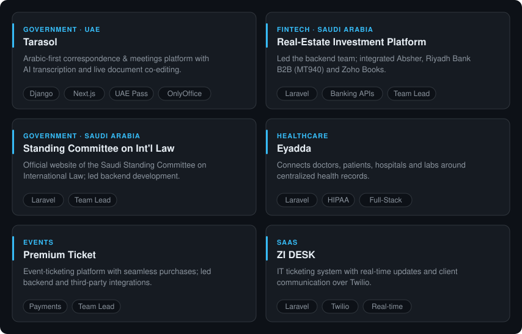
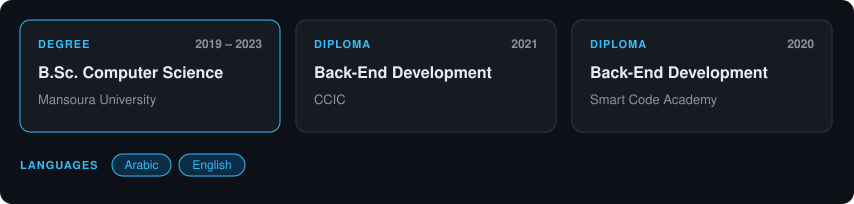

  <b>Full-Stack Developer &amp; Team Lead</b> · 6+ years · Dubai, UAE 
  Building Arabic-first government and financial platforms with Django, Laravel and Next.js

  
  
  
  

---

### About

Full-stack developer and team lead with **6+ years** delivering secure, scalable systems for **government, fintech, e-commerce, and healthcare**. I currently lead development of government digital-transformation systems at the **Crown Prince's Office in Fujairah**, specializing in Arabic-first bilingual applications with Django backends and Next.js frontends.

**Strengths:** system architecture & microservices · UAE Pass / OAuth2 SSO · AI integration (Arabic speech-to-text, summarization) · Arabic RTL interfaces · leading and mentoring backend teams

### Experience

### Selected Projects

Most of this work is under NDA, so the code lives in private repositories.

### Tech Stack

   
   
   
  

### GitHub Activity

  

  
  

### Education

### Contact

  
  

